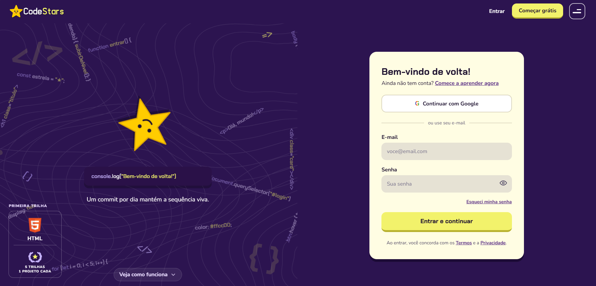
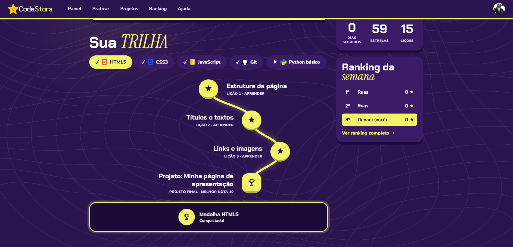
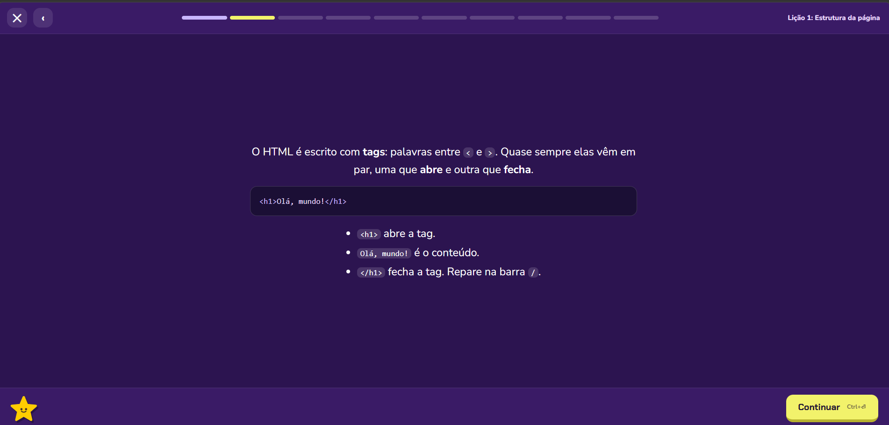
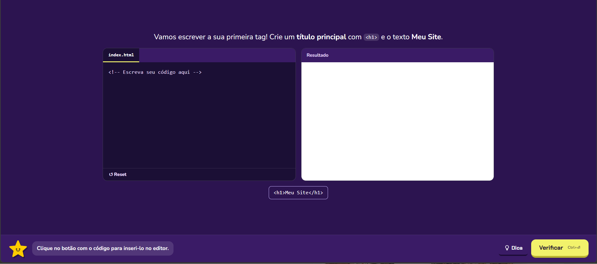
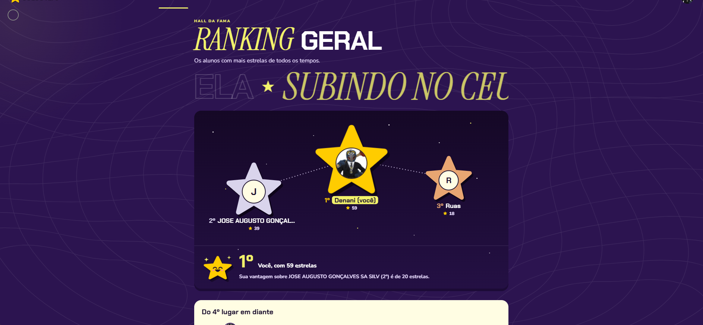
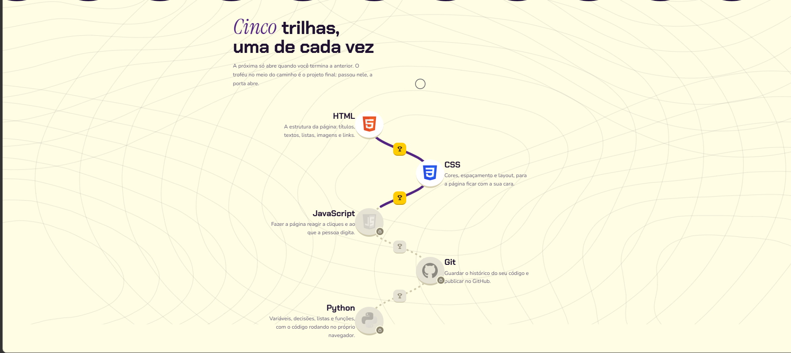
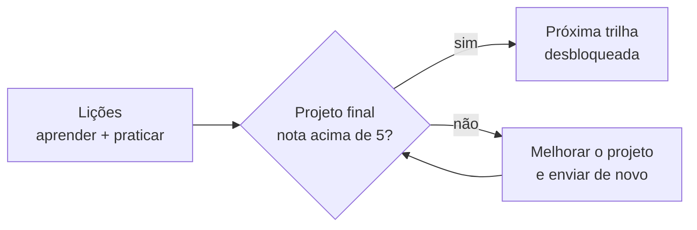
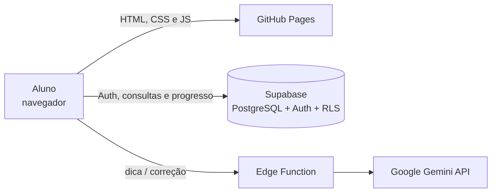

<div align="center">


### Aprenda programação do zero, passo a passo, com um tutor que pergunta em vez de entregar a resposta.

<br>

[](https://joseaugusto271.github.io/CodeStars/)


<br>



</div>

O [CodeStars](https://joseaugusto271.github.io/CodeStars/) é uma plataforma web gamificada para aprender programação na prática. O aluno estuda **HTML, CSS, JavaScript, Git e Python** escrevendo código de verdade desde a primeira lição, em um editor que mostra o resultado ao lado, em tempo real.

O grande diferencial é o **Tutor Socrático com Inteligência Artificial**: quando o aluno trava, a IA faz perguntas e dá pistas, em vez de entregar a resposta pronta. A plataforma também avalia a **qualidade do código** (*Clean Code*), e não apenas se ele funciona.

Projeto desenvolvido como **Trabalho de Conclusão de Curso (TCC)**.



## Índice

- [Funcionalidades](#funcionalidades)
    - [Aprender](#aprender)
    - [Praticar e criar](#praticar-e-criar)
    - [Gamificação](#gamificação)
    - [Conta e personalização](#conta-e-personalização)
- [Como a avaliação funciona](#como-a-avaliação-funciona)
- [Trilhas de aprendizagem](#trilhas-de-aprendizagem)
- [Arquitetura e tecnologias](#arquitetura-e-tecnologias)
- [Design e experiência](#design-e-experiência)
- [Como executar localmente](#como-executar-localmente)
    - [Clonar o repositório](#clonar-o-repositório)
    - [Banco de dados](#banco-de-dados)
    - [Chaves do Supabase](#chaves-do-supabase)
    - [Login](#login)
    - [Inteligência Artificial](#inteligência-artificial-opcional)
    - [Abrir o site](#abrir-o-site)
- [Estrutura do projeto](#estrutura-do-projeto)
- [Segurança e privacidade](#segurança-e-privacidade)
- [Ideias para o futuro](#ideias-para-o-futuro)
- [Links](#links)

## Funcionalidades

### Aprender

* **IDE interativa (split-screen):** editor de código de um lado e resultado renderizado em tempo real do outro
* **Autocompletar nos editores:** fecha tags, aspas e parênteses, completa `</` e recua o código ao apertar Enter, como em um editor profissional
* **Verificação automática:** o aluno confere o exercício com um clique (ou `Ctrl + Enter`) e vê o que já está certo
* **Tutor Socrático por IA:** dicas reflexivas com o Google Gemini, sem entregar a resposta
* **Projeto final por trilha:** corrigido por IA. Passou da nota 5, a próxima trilha é liberada

Cada lição começa com uma explicação curta, com exemplos de código:



E termina com um exercício prático, no editor, com dica e verificação:



### Praticar e criar

* **Praticar:** desafios de código e quizzes para fixar o conteúdo. Não valem estrela, então dá para errar e repetir à vontade
* **Projetos livres:** editor de HTML, CSS e JavaScript com console, salvamento automático na conta e divisor arrastável entre o código e o resultado

### Gamificação

* **Estrelas:** de 1 a 3 por lição, conforme a qualidade do código
* **Sequência (ofensiva):** dias seguidos de estudo, com meta diária de lições (1, 2, 3 ou 5) e lembrete opcional por e-mail
* **Ranking:** classificação **semanal** e **geral** entre todos os alunos
* **Medalhas:** uma medalha ao concluir cada trilha

O ranking geral mostra o pódio, a posição do aluno e quantas estrelas faltam para passar o próximo:



### Conta e personalização

* **Autenticação:** e-mail e senha ou **Google OAuth**, com o Supabase Auth
* **Perfil:** nome, foto, meta diária e lembrete
* **Temas:** claro, escuro ou automático
* **Central de ajuda:** guia rápido, perguntas frequentes com busca, atalhos do editor e formulário de contato

## Como a avaliação funciona

Cada lição de código recebe de **1 a 3 estrelas**:

| Critério | O que é observado |
|---|---|
| **Funcionalidade** | O código cumpre o que o exercício pede |
| **Estruturação** | Uso correto e organizado da linguagem (por exemplo, tags e seletores adequados) |
| **Clean Code** | Ausência de redundâncias e de repetições desnecessárias |

**Nota:** se o aluno pedir ajuda à IA, a nota máxima daquela lição fica **travada em 1 estrela**. A ajuda é bem-vinda, mas a recompensa maior fica para quem resolve por conta própria.

## Trilhas de aprendizagem

São cinco trilhas, e cada uma só abre quando a anterior termina. O troféu no meio do caminho é o **projeto final**: passou nele, a porta abre.

| # | Trilha | O que o aluno aprende |
|:-:|---|---|
| 1 | **HTML** | A estrutura da página: títulos, textos, listas, imagens e links |
| 2 | **CSS** | Cores, espaçamento e layout, para a página ficar com a sua cara |
| 3 | **JavaScript** | Fazer a página reagir a cliques e ao que a pessoa digita |
| 4 | **Git** | Guardar o histórico do código e publicar no GitHub |
| 5 | **Python** | Variáveis, decisões, listas e funções, com o código rodando no próprio navegador |





## Arquitetura e tecnologias



**Front-end**

* HTML5, CSS3 e JavaScript puro, em um site estático (sem etapa de build)
* Hospedagem contínua via **GitHub Pages**

**Back-end e banco de dados**

* **Supabase:** banco de dados relacional (PostgreSQL)
* **Supabase Auth:** autenticação segura de usuários (e-mail e senha e Google OAuth)
* **RLS (*Row Level Security*):** políticas de segurança nativas do banco para proteger os dados e o progresso dos alunos

**Inteligência Artificial**

* **API do Google Gemini:** modelo `gemini-1.5-flash`, via Edge Functions, para a correção dos projetos finais e a tutoria socrática

## Design e experiência

A interface tem um visual lúdico, mas com acabamento de produto: estrela mascote, tipografia grande, curvas de nível ao fundo e animações que reagem ao mouse e à rolagem.

| Cor | Código | Uso |
|---|---|---|
| Roxo | `#2C1450` | Fundo principal |
| Roxo escuro | `#1C0B36` | Superfícies e sombras |
| Amarelo | `#F2F26B` | Destaques, botões e recompensas |
| Menta | `#7FF0C0` | Acertos e conclusões |
| Creme | `#FFFDE3` | Cartões e áreas de leitura |

**Fontes:** Chakra Petch (títulos), Nunito (textos) e Instrument Serif (palavras de destaque).

* Temas **claro e escuro**, com opção de seguir o sistema
* **Responsivo**, do celular ao desktop
* **Acessível:** navegação por teclado, foco visível e respeito à preferência de **movimento reduzido** do sistema

## Como executar localmente

O site é estático: não há dependências para instalar nem etapa de build. O que precisa ser configurado é o **Supabase**. Você precisa de um navegador moderno, de uma conta gratuita no [Supabase](https://supabase.com) e, se quiser subir um servidor local com um comando, do [Node.js](https://nodejs.org).

### Clonar o repositório

```bash
git clone https://github.com/joseaugusto271/CodeStars.git
cd CodeStars
```

### Banco de dados

Crie um projeto no Supabase, abra o **SQL Editor** e execute os arquivos SQL do repositório:

| Arquivo | O que instala |
|---|---|
| `schema.sql` | Estrutura do banco (tabelas) e regras de segurança (RLS) |
| `licoes-conteudo.sql` | O conteúdo das lições |
| `projeto-final.sql` | Os projetos finais de cada trilha |
| `praticar-ranking-ajuda.sql` | Desafios, quizzes, ranking geral e formulário de ajuda |

**Nota:** se algum arquivo faltar, o próprio site avisa na tela qual deles precisa ser executado.

### Chaves do Supabase

No começo do `app.js`, na seção **CONFIGURAÇÃO DO SUPABASE**, preencha:

```js
const SUPABASE_URL      = 'https://SEU-PROJETO.supabase.co';
const SUPABASE_ANON_KEY = 'SUA_CHAVE_ANON_PUBLIC';
```

Os dois valores ficam em **Project Settings → API** (use a chave `anon public`).

### Login

* Em **Authentication → Providers**, ative **Email** e, se quiser, **Google**
* Em **Authentication → URL Configuration**, adicione o endereço local (por exemplo `http://localhost:3000`) e o do GitHub Pages à lista de URLs permitidas

### Inteligência Artificial (opcional)

Se a sua instalação usa as Edge Functions de tutoria e correção, publique-as com a [Supabase CLI](https://supabase.com/docs/guides/cli) e guarde a chave do Gemini como *secret* da função.

**Nota:** a chave do Gemini nunca deve ir para o `app.js` nem para o repositório.

### Abrir o site

Dê dois cliques no `index.html` ou, de preferência (principalmente para o login com Google), suba um servidor local:

```bash
npx serve .
```

Depois é só abrir o endereço que o comando mostrar.

## Estrutura do projeto

```text
CodeStars/
├── index.html              # Estrutura das telas (login, painel, praticar, projetos, ranking, ajuda, lições)
├── style.css               # Estilos, tokens de design e temas claro/escuro
├── app.js                  # Lógica do app, integração com o Supabase e animações
├── logo-codestars.svg      # Logotipo
├── icone-*.png             # Ícones das trilhas (HTML, CSS, JavaScript, Git, Python)
├── *.sql                   # Scripts do banco, para rodar no SQL Editor do Supabase
└── docs/
    └── screenshots/        # Capturas de tela usadas neste README
```

## Segurança e privacidade

* **RLS protege os dados do aluno:** as regras ficam no banco, não no site. Mesmo com a chave pública, ninguém acessa o progresso de outra pessoa
* **A chave `anon public` pode ficar no site**, ela foi feita para isso. Já a chave `service_role` e a chave do Gemini **nunca** devem ser enviadas ao repositório
* O texto digitado pelo aluno é escapado antes de ser exibido na página
* A autenticação (inclusive o Google OAuth) é feita pelo Supabase Auth

## Ideias para o futuro

* Migrar o front-end para **React/Next.js**, mantendo o Supabase como back-end
* Ampliar o banco de lições, desafios e quizzes
* Adicionar testes automatizados para as regras de avaliação
* Painel para o professor acompanhar a evolução da turma

## Links

* [Plataforma no ar](https://joseaugusto271.github.io/CodeStars/)
* [Código-fonte](https://github.com/joseaugusto271/CodeStars)
* [Reportar um problema](https://github.com/joseaugusto271/CodeStars/issues)
